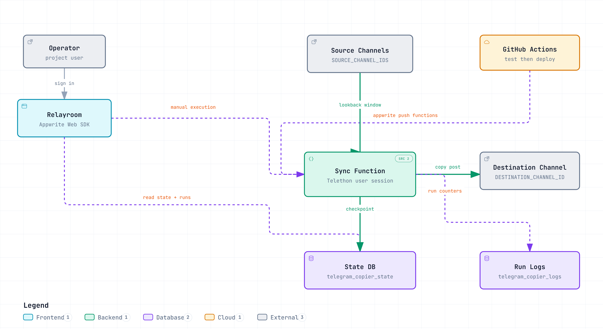
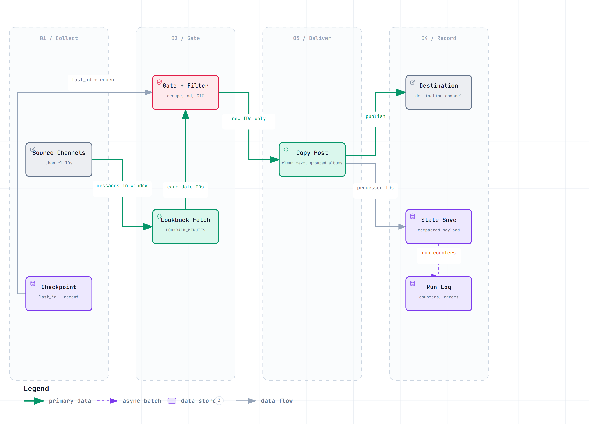
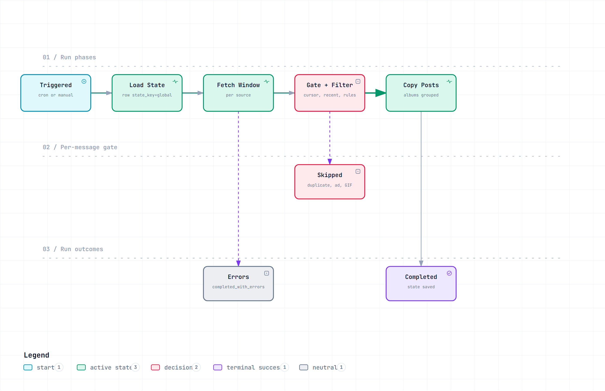

# Telegram Copier

[](https://github.com/cursorcorpx/telegram_copier/actions/workflows/appwrite-ci-cd.yml)
[](https://www.python.org/)
[](https://appwrite.io/docs/products/functions)
[](https://docs.telethon.dev/)

Scheduled, deduplicated repost pipeline that mirrors one or more Telegram source channels into a
single destination channel. It runs as an Appwrite Function on a Telethon **user session**, keeps its
checkpoint in Appwrite, and exposes a read-only dashboard for operators.

---

## Table of contents

- [What it does](#what-it-does)
- [Architecture](#architecture)
- [Data flow](#data-flow)
- [Run lifecycle](#run-lifecycle)
- [Repository layout](#repository-layout)
- [Quick start](#quick-start)
- [Configuration](#configuration)
- [State model](#state-model)
- [Observability](#observability)
- [Relayroom dashboard](#relayroom-dashboard)
- [Deployment and CI/CD](#deployment-and-cicd)
- [Operations and troubleshooting](#operations-and-troubleshooting)
- [Security](#security)
- [Development](#development)
- [Diagrams](#diagrams)
- [Roadmap](#roadmap)
- [Contributing](#contributing)

---

## What it does

- Copies messages from one or many source channels into one destination channel.
- Runs on an Appwrite Function schedule (`interval: 60`) and on manual execution.
- Authenticates as a real Telegram user (`SESSION_STRING`), not a bot, so it can read channels a bot cannot join.
- Fetches a strict time window (`LOOKBACK_MINUTES`) and reposts only IDs the run has not handled yet.
- Deduplicates with a per-source cursor (`last_id`) plus a bounded `recent` ID window.
- Sanitizes text, blocks ads and GIFs, and keeps albums grouped.
- Persists checkpoints, run snapshots, and run counters in Appwrite.
- Recovers gracefully from flood waits, restricted chats, and invalidated sessions.

### Behaviour guarantees

| Guarantee | Mechanism |
| --- | --- |
| No duplicate reposts | Per-source `last_id` cursor + `recent` ID window (`ENABLE_CURSOR_GATE=1`) |
| No gaps across runs | Timestamp lookback window, plus optional run-snapshot recovery |
| Checkpoint survives crashes | State is written before work starts and again after delivery |
| One bad source cannot stop the run | Per-source error capture into `source_errors`, status `completed_with_errors` |
| Long runs cannot hang forever | Function timeout `300s`; flood wait halts and reports `flood_wait_seconds` |

---

## Architecture



Open the interactive version: **[docs/diagrams/architecture.html](docs/diagrams/architecture.html)** —
it supports hover, semantic search, route tracing, and light/dark themes.

| Component | Role |
| --- | --- |
| **Relayroom** (`frontend/`) | Operator dashboard. Reads state and run history with the Appwrite Web SDK and starts manual executions. |
| **Sync Function** (`telegram-copier-webhook`) | Python 3.12 Appwrite Function. Owns the Telethon client, filters, and delivery. |
| **Source Channels** | One or many Telegram channels defined by `SOURCE_CHANNEL_IDS`. |
| **Destination Channel** | Single target channel defined by `DESTINATION_CHANNEL_ID`. |
| **State DB** (`telegram_copier_state`) | Single row (`state_key=global`) with cursors, recent ID windows, and last-run metadata. |
| **Run Logs** (`telegram_copier_logs`) | Per-run counters, skip breakdown, and per-source stats. |
| **GitHub Actions** | Runs tests on pull requests, deploys functions on merge to `main`. |

---

## Data flow



Open the interactive version: **[docs/diagrams/data-flow.html](docs/diagrams/data-flow.html)**.

1. **Collect** — load the checkpoint, then fetch each source by message timestamp inside the lookback window.
2. **Gate** — build the candidate set from live fetch plus optional run snapshots, then drop duplicates,
   cursor-gated IDs, ads, and GIFs.
3. **Deliver** — send or copy the surviving messages to the destination channel, grouping albums.
4. **Record** — advance the per-source cursor, compact the state payload, and write the run log.

Gate order matters: cheap ID comparisons run before any network call, so an hourly run with no new
messages costs one fetch per source and no sends.

---

## Run lifecycle



Open the interactive version: **[docs/diagrams/run-lifecycle.html](docs/diagrams/run-lifecycle.html)**.

A run always walks the same phase rail: load state, fetch window, gate, copy. Outcomes are:

- **Completed** — the function finished and the state was saved.
- **Completed with errors** — at least one source failed; the rest of the run still delivered.
- **Skipped messages** — expected and counted, never an error.

Two exits are not modelled as states because they are runtime interruptions, not outcomes:

- **Flood wait** returns `flood_wait_seconds` and `halted=1`. The last good checkpoint stays intact.
- **Invalid session** (`AuthKeyDuplicatedError`) fails at connect and asks for a new `SESSION_STRING`.

`completed` means *the function finished*, not *every message landed*. Use the run counters to judge
delivery.

---

## Repository layout

```text
telegram_copier/
├── appwrite.json                     # Appwrite project + function definitions
├── appwrite/functions/
│   ├── webhook/src/main.py           # Scheduled sync function (production path)
│   └── album_flush/src/main.py       # Album flush placeholder (no-op)
├── frontend/                         # Relayroom operator dashboard (vanilla JS + Appwrite Web SDK)
├── docs/diagrams/                    # Diagram specs (.json), interactive HTML, README PNGs
├── scripts/render-diagrams.mjs       # Re-renders docs/diagrams/*.png from the HTML
├── tests/                            # pytest suite for config, sync, and function handlers
├── main.py                           # Local/docker long-running Telethon client
├── config.py                         # Local runtime configuration
└── generate_session_string.py        # Creates a Telethon StringSession
```

---

## Quick start

### 1. Create a session string

```bash
python -m venv .venv
source .venv/bin/activate          # Windows: .venv\Scripts\Activate.ps1
pip install -r requirements.txt
python generate_session_string.py
```

The script prints a `SESSION_STRING`. Treat it as a password: it grants full account access.

### 2. Configure the function

In Appwrite, open **Telegram Copier User Sync** → *Settings* → *Variables* and set the required values
from the [configuration table](#configuration). Minimum viable set:

```text
API_ID=123456
API_HASH=0123456789abcdef0123456789abcdef
SESSION_STRING=1BVtsOK...
DESTINATION_CHANNEL_ID=-1001234567890
SOURCE_CHANNEL_IDS=-1001111111111,-1002222222222
```

### 3. Deploy

```bash
appwrite login
appwrite push functions
```

### 4. Verify

Run the function once manually, then check:

- the destination channel received new posts;
- the execution response reports `copied > 0` and `state_saved=1`;
- `telegram_copier_state` row `state_key=global` advanced its cursors.

---

## Configuration

All variables are function-level Appwrite environment variables.

### Required

| Variable | Description |
| --- | --- |
| `API_ID` | Telegram API ID from <https://my.telegram.org>. |
| `API_HASH` | Telegram API hash. |
| `SESSION_STRING` | Telethon `StringSession` for the copying account. |
| `DESTINATION_CHANNEL_ID` | Target channel ID (numeric, `-100…`). |
| `SOURCE_CHANNEL_ID` / `SOURCE_CHANNEL_IDS` | One source, or a comma-separated list of sources. |

### Optional

| Variable | Default | Range / values | Purpose |
| --- | --- | --- | --- |
| `LIMIT_PER_SOURCE` | `50` | `1..200` | Max messages fetched per source per run. |
| `LOOKBACK_MINUTES` | `60` | `1..1440` | Time window scanned by message timestamp. |
| `ENABLE_CURSOR_GATE` | `1` | `0`/`1` | Skip IDs at or below the source cursor. Disable only for replay/debug. |
| `ENABLE_SNAPSHOT_RECOVERY` | `0` | `0`/`1` | Merge recent run-snapshot IDs into the candidate set. |
| `ENABLE_TELEGRAM_STATE_FALLBACK` | `0` | `0`/`1` | Fall back to Saved Messages state when Appwrite is unavailable. |
| `COPY_MODE` | `copy` | `copy`/`forward`/`0` | `copy` posts as your own message with no forward header. |
| `BLOCK_GENERIC_AD_WORD` | `0` | `0`/`1` | Also block messages containing the standalone word `ad`. |
| `STRIP_T_LINKS` | `0` | `0`/`1` | Remove `t.me` / `telegram.me` links. |
| `STRIP_YOUTUBE_LINKS` | `0` | `0`/`1` | Remove `youtube.com` links. |
| `FILTER_BAD_WORDS` | *(empty)* | CSV | Remove these whole words from text. |
| `SOURCE_CHANNEL_USERNAMES` | *(empty)* | CSV | Ordered fallback usernames for public sources missing from the entity cache. |
| `DB_STATE_PAYLOAD_MAX_CHARS` | `3600` | int | State compaction threshold. |
| `DB_LOG_IDS_MAX_CHARS` | `800` | int | Max length of ID lists written to the run log. |
| `APPWRITE_STATE_DATABASE_ID` / `APPWRITE_STATE_COLLECTION_ID` | function DB / `telegram_copier_state` | string | State location overrides. |
| `APPWRITE_LOGS_COLLECTION_ID` | `telegram_copier_logs` | string | Run log collection override. |

### Hard filters (always on)

- Ad markers: `#ad`, `insideads*`.
- GIF messages and `.gif` media.
- Invalid or empty payloads after sanitization.

---

## State model

State lives in `telegram_copier_state` as one row with `state_key=global`:

```json
{
  "state_key": "global",
  "payload": {
    "sources": {
      "<channel_id>": {
        "last_id": 123456,
        "recent": [123450, 123451, 123456],
        "updated_at_ist": "2026-10-31T09:00:00+05:30",
        "updated_at_utc": "2026-10-31T03:30:00+00:00"
      }
    },
    "meta": {
      "last_run_ts_ms": 1793422200000,
      "last_run_at_ist": "2026-10-31T09:00:00+05:30",
      "status": "completed",
      "copied": 4,
      "fetched": 11,
      "source_errors": []
    }
  }
}
```

Rules:

- `last_id` is the highest processed message per source. `recent` is the bounded dedupe window.
- `meta.status` is one of `running`, `completed`, `completed_with_errors`, `halted`.
- Payloads above `DB_STATE_PAYLOAD_MAX_CHARS` are compacted before write, so a large `recent` window
  cannot trigger a `MessageTooLongError`.
- The loader returns the real row `$id` even after compaction, so saves update instead of inserting.

Optional Telegram mirror (markers in Saved Messages, disabled by default):

- `telegram_copier_state_v1:…` — checkpoint copy.
- `telegram_copier_run_v1:…` — per-run ID snapshot, used by snapshot recovery.

---

## Observability

Every run returns counters and writes a row to `telegram_copier_logs`.

| Group | Fields |
| --- | --- |
| Core | `copied`, `fetched`, `skipped_invalid`, `filtered_links`, `sources_with_new_messages`, `source_errors_count` |
| Skips | `skipped_invalid_runtime`, `skipped_duplicate_recent`, `skipped_cursor_gate`, `skipped_blocked_ad`, `skipped_blocked_gif` |
| State | `state_saved`, `state_message_id`, `updated_sources` |
| Snapshots | `run_snapshot_count`, `run_snapshot_message_ids` |
| Per source | `source_run_stats` — `f=` fetched, `c=` copied, `g=` cursor gate, `r=` recent duplicate, `a=` ad block, `i=` gif block, `w=` min-max count |

Execution logs also include a coverage line (`Source coverage: checked=<n>/<total>`) and one compact
line per configured source. Logs are trimmed at 8000 characters, so per-source output stays terse.

### Reading a run

| Symptom | First check |
| --- | --- |
| `copied=0`, `fetched>0` | Skip breakdown — usually `r` (duplicate) or `g` (cursor gate). |
| `copied=0`, `fetched=0` | Lookback window too short for the schedule, or source IDs wrong. |
| `source_errors_count>0` | `source_errors` entries name the channel and the failure. |
| `halted=1` | Flood wait; wait `flood_wait_seconds` and re-run. |

---

## Relayroom dashboard

`frontend/` is a static dashboard built on the Appwrite Web SDK. It shows source checkpoints, run
history, and counters, and can submit a manual execution.

```bash
cd frontend
npm ci
npm run dev
```

Setup requires an Appwrite **Web platform**, a project-user session, and read permission on the state
and log collections. Connection IDs are entered in the setup form — never commit API keys or Telegram
secrets to frontend files. See [frontend/README.md](frontend/README.md) for permissions and
data-availability limits.

---

## Deployment and CI/CD

`.github/workflows/appwrite-ci-cd.yml`:

| Trigger | Behaviour |
| --- | --- |
| `pull_request` → `main` | Tests only. |
| `push` → `main` | Tests, then `appwrite push functions`. |
| `workflow_dispatch` | Manual tests + deploy. |

Jobs:

1. **test** — Python 3.12, installs `requirements.txt` + `requirements-dev.txt`, runs `python -m pytest -q`.
2. **deploy** — needs `test`, installs Node.js and `appwrite-cli`, authenticates with repository secrets,
   runs `appwrite push functions`.

Required GitHub secrets:

| Secret | Value |
| --- | --- |
| `APPWRITE_ENDPOINT` | e.g. `https://cloud.appwrite.io/v1` |
| `APPWRITE_PROJECT_ID` | Appwrite project ID |
| `APPWRITE_API_KEY` | Key with function deploy permission |

Recommended: attach the `deploy` job to a protected `production` environment with required reviewers,
and keep production secrets environment-scoped.

`appwrite.json` defines two functions:

| Function | Runtime | Timeout | Schedule |
| --- | --- | --- | --- |
| `telegram-copier-webhook` | `python-3.12` | 300s | every 60 minutes |
| `telegram-copier-album-flush` | `python-3.12` | 30s | none (placeholder) |

The current Appwrite plan rejects intervals below 60 minutes. With `LOOKBACK_MINUTES=120` the last hour
stays fully covered even when a run is delayed.

---

## Operations and troubleshooting

| Problem | Cause | Fix |
| --- | --- | --- |
| `AuthKeyDuplicatedError` | Telegram invalidated the session (used by two runtimes). | Generate a new `SESSION_STRING`, update the variable, redeploy, and keep the session exclusive to this function. |
| `Invalid query: Syntax error` | Legacy Appwrite query strings. | The function sends JSON queries first and falls back to legacy only if rejected. Upgrade Appwrite or keep the fallback. |
| `row_unique_constraint_violation` on `state_key=global` | A failed list call left the saver without a row ID. | Fixed: the loader returns the real `$id` and the saver reuses the existing row. |
| State message too long | Oversized payload. | Handled by compaction; lower `LOOKBACK_MINUTES` or `LIMIT_PER_SOURCE` if it recurs. |
| Nothing copied for hours | Cursor ahead of the fetched range. | Cursor self-heal relaxes gating for that source; verify `g=` in `source_run_stats`. |
| `403` / restricted chat | Source blocks forwarding. | Fallback repost path sends text/media directly. |
| Web page media crash | `MessageMediaWebPage` is not sendable. | Treated as text; no action needed. |

Ops checklist after a deploy:

1. `appwrite push functions`, then confirm the deployment is active.
2. Verify function variables.
3. Run once manually and inspect `copied`, `fetched`, `source_errors_count`, `state_saved`.
4. Confirm destination messages and the state row update.

---

## Security

- `SESSION_STRING` grants full account access. Store it only in Appwrite function variables or GitHub
  secrets; never in the repository, frontend bundle, or logs.
- `API_HASH`, channel IDs, and the Appwrite API key are equally sensitive.
- Do not commit `.env` files. Rotate the session immediately if it leaks or is reused elsewhere.
- The dashboard uses project-user sessions with read-only collection access; it never receives
  Telegram credentials.
- Deploy keys should be scoped to function deployment only.

---

## Development

```bash
pip install -r requirements-dev.txt
python -m pytest -q
```

Frontend checks:

```bash
cd frontend
npm ci
npm test
npm run build
npm run test:browser      # requires: npx playwright install chromium
```

Browser tests mock Appwrite HTTP calls; they verify UI behaviour, not production connectivity.

Local long-running client (optional, not the production path):

```bash
python main.py
```

List channel IDs for configuration:

```bash
python print_dialog_ids.py
```

---

## Diagrams

The three diagrams are authored as Archify JSON specs, delivered as self-contained interactive HTML,
and rendered to PNG for this README.

| File | Purpose |
| --- | --- |
| `docs/diagrams/architecture.json` | Component topology. |
| `docs/diagrams/data-flow.json` | Four-stage pipeline. |
| `docs/diagrams/run-lifecycle.json` | Phase rail and run outcomes. |
| `docs/diagrams/*.html` | Interactive deliverables — open directly in a browser. |
| `docs/diagrams/*.png` | Rendered images embedded above. |

Regenerate the PNGs after editing a spec:

```bash
node scripts/render-diagrams.mjs
```

The script needs Playwright Chromium from `frontend/node_modules`:

```bash
cd frontend && npm ci && npx playwright install chromium
```

---

## Roadmap

1. **Source-level controls** — per-source enable/disable and per-source filter policies.
2. **Deeper observability** — structured exports and trend charts in Relayroom.
3. **Retry policy** — bounded retries for transient Telegram RPC errors and smarter flood-wait backoff.
4. **Staged rollout** — optional staging deploy before production, with environment approvals.

Longer-term AI integration points (pre-send classifier, text transform, policy assistant) are described
in [`AI.Readme.md`](AI.Readme.md).

---

## Contributing

1. Branch from the latest `main`.
2. Keep changes focused; small PRs review faster.
3. Add or update tests for behaviour changes.
4. Run `python -m pytest -q` and the frontend checks.
5. Update docs when runtime behaviour changes: `README.md`, `AGENTS.md`, `APPWRITE_DEPLOY.md`.
6. Open a PR with the problem statement, behaviour change, test evidence, and deployment notes.
7. Merging to `main` deploys to production — never merge with failing CI, and call out deploy impact
   when `appwrite.json` or `appwrite/functions/**` change.
